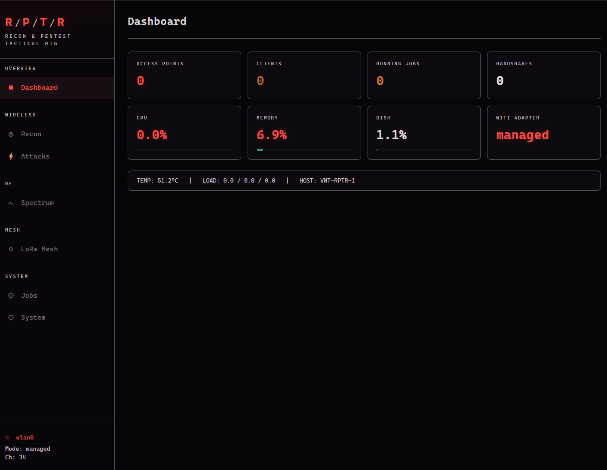

# R/P/T/R — Recon & Pentest Tactical Rig

Tactical RF dashboard for Raspberry Pi pentesting rigs. Built with Flask, HTMX, and Server-Sent Events for real-time updates. Dark tactical theme with red accent palette.



## Features

- **WiFi Recon** — Passive scanning via tshark with live AP/client/probe tables, signal tracking, and channel hopping
- **Attack Controls** — Deauth (aireplay-ng/mdk4), WPS (reaver/bully), handshake capture, nmap scanning, evil twin (hostapd/dnsmasq)
- **RTL-SDR Spectrum** — Spectrum analyzer with canvas waterfall display, frequency presets (WiFi, ISM, FM, ADS-B, AIS)
- **MeshCore LoRa Mesh** — LoRa mesh networking via MeshCore Python API — contacts, messaging, telemetry, device config
- **Job Queue** — Background task runner with live output streaming, cancel support, status tracking
- **System Status** — CPU, memory, disk, temperature, USB devices, wireless interface management

## Tech Stack

| Component | Technology |
|-----------|-----------|
| Backend | Python Flask + Gunicorn (gthread workers) |
| Frontend | HTMX + vanilla JS (spectrum canvas) |
| Real-time | Server-Sent Events |
| Database | SQLite (WAL mode) |
| Task runner | ThreadPoolExecutor + subprocess |
| Auth | Token-based with cookie sessions |

## Requirements

- Raspberry Pi (or any Linux box) with root access
- Python 3.10+
- WiFi adapter supporting monitor mode (e.g. RTL8812AU)
- RTL-SDR dongle (optional, for spectrum analysis)
- MeshCore LoRa board (optional, for mesh networking)
- Pentesting tools: `aircrack-ng`, `mdk4`, `tshark`, `nmap`, `reaver`, `hostapd`, `dnsmasq`, `rtl_power`

## Setup

```bash
# Clone
git clone https://github.com/hifisol/rptr-webui.git
cd rptr-webui

# Virtual environment
python3 -m venv venv
source venv/bin/activate
pip install -r requirements.txt

# Configuration
cp config.yaml.example config.yaml
# Edit config.yaml — set your auth token, bind address, interface name, etc.

# Initialize database
mkdir -p data
sqlite3 data/rptr.db < migrations/schema.sql

# Run (development)
python app.py

# Run (production)
gunicorn --bind 0.0.0.0:8443 --workers 2 --threads 4 --worker-class gthread --timeout 300 app:app
```

## Systemd Service

```bash
# Copy and edit the service file
sudo cp rptr-webui.service /etc/systemd/system/
# Edit bind address, paths as needed
sudo systemctl daemon-reload
sudo systemctl enable --now rptr-webui
```

## Configuration

Copy `config.yaml.example` to `config.yaml` and customize:

| Setting | Description |
|---------|-------------|
| `auth.token` | Access token for authentication |
| `server.host` | Bind address (`0.0.0.0` for all interfaces) |
| `server.port` | Listen port (default `8443`) |
| `interfaces.wifi` | WiFi adapter name (e.g. `wlan0`) |
| `mesh.serial_port` | MeshCore LoRa serial device (e.g. `/dev/ttyUSB0`) |
| `mesh.enabled` | Enable/disable MeshCore integration |
| `sdr.device_index` | RTL-SDR device index |

## Playbooks

Repeatable workflows for the appliances in the RPTR stack live in [`Playbooks/`](Playbooks/README.md). The index lists each playbook and its status.

## Project Structure

```
rptr-webui/
├── app.py                  # Flask app factory + SSE endpoints
├── config.yaml.example     # Configuration template
├── rptr-webui.service      # systemd unit
├── requirements.txt
├── core/
│   ├── auth.py             # Token auth + rate limiting
│   ├── config.py           # YAML config loader
│   ├── database.py         # SQLite helpers (WAL mode)
│   ├── events.py           # SSE event bus (pub/sub)
│   └── tasks.py            # Background job runner
├── tools/
│   ├── wifi_scanner.py     # tshark passive scanning
│   ├── interface.py        # Monitor mode, channel, MAC
│   ├── mesh_manager.py     # MeshCore async-to-sync bridge
│   └── system.py           # System info (psutil)
├── blueprints/
│   ├── dashboard.py        # Overview page
│   ├── recon.py            # WiFi scanning
│   ├── attacks.py          # Attack controls
│   ├── sdr.py              # Spectrum analyzer
│   ├── mesh.py             # LoRa mesh networking
│   ├── jobs.py             # Job queue
│   └── system.py           # System status
├── templates/              # Jinja2 + HTMX partials
├── static/
│   ├── css/pager.css       # Dark tactical theme
│   └── js/
│       ├── app.js          # SSE handler, utilities
│       └── spectrum.js     # Canvas spectrum/waterfall
└── migrations/schema.sql   # SQLite schema
```

## Security Notes

- Runs as root (required for monitor mode, aircrack-ng, hostapd)
- All subprocess calls use argument lists (no `shell=True`)
- Input validation: BSSID regex, SSID sanitization, nmap flag whitelist
- Attack safety lock with confirmation dialogs
- Bind to a specific interface (Tailscale, VPN, localhost) rather than `0.0.0.0` in production
- Change the default auth token before deployment

## License

MIT
